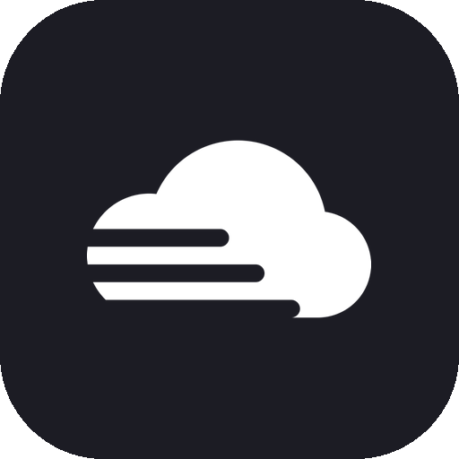
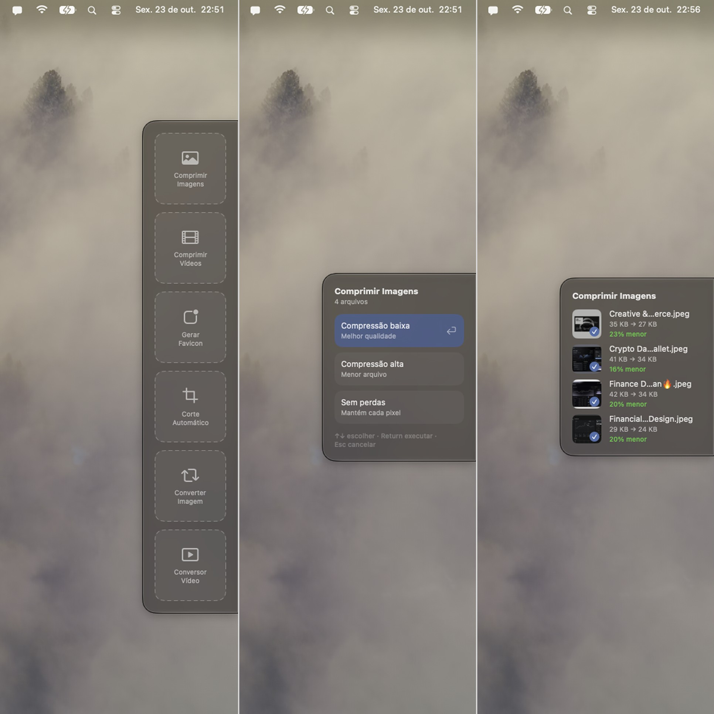

<p align="center">
  
</p>

<h1 align="center">Nimbus</h1>

<p align="center"><b>Compress and convert images and videos from the macOS menu bar.</b></p>

<p align="center">
  
  
  
  <a href="LICENSE"></a>
  <a href="https://github.com/CarlosAllberto/nimbus/actions/workflows/ci.yml"></a>
</p>

<p align="center">
  <a href="#features">Features</a> &bull;
  <a href="#install">Install</a> &bull;
  <a href="#usage">Usage</a> &bull;
  <a href="#build-from-source">Build from source</a> &bull;
  <a href="#how-it-works">How it works</a>
</p>

<p align="center">English &bull; <a href="README.pt-BR.md">Português</a></p>

Drag a file, pick an option, done. Nimbus is a macOS menu-bar app that compresses and converts images and videos from a small popup that slides in from the edge of your screen. Everything runs on your Mac, with no account and no upload.



## Features

- **Compress Images**: shrink images at low, high, or lossless compression, or convert them to WebP.
- **Compress Videos**: re-encode a video as a smaller WebM.
- **Favicon Generator**: turn an image into a browser favicon (`.ico`).
- **Auto Crop**: trim an image down to its content.
- **Image Converter**: convert between PNG, JPG, and WebP.
- **Video Converter**: convert between MP4, MOV, and WebM.
- Per-file progress with the size before and after, and the percentage saved.
- Results are saved to `~/Nimbus`; originals are never touched.
- Keyboard friendly: arrows to choose, Return to run, Esc to cancel.
- Available in English and Brazilian Portuguese.

## Install

Download the latest `Nimbus.zip` from the [releases page](https://github.com/CarlosAllberto/nimbus/releases/tag/latest), unzip it, and move `Nimbus.app` to `/Applications`.

> [!NOTE]
> Builds are not signed with an Apple Developer ID yet. On first launch, right-click `Nimbus.app` and choose **Open**, or allow it in **System Settings > Privacy & Security**.

Requires macOS 14 or later. Once installed, Nimbus updates itself with Sparkle.

## Usage

1. Open Quick Drop with **⌥Q**, from the menu-bar icon, or by dragging files while holding **⌘**.
2. Drop the files on a tool.
3. Pick an option, such as the compression level, and press Return.
4. Find the results in `~/Nimbus`.

Hold **⌘** while dragging to bring the popup up from anywhere; release it and the popup slides away again. Dragging without **⌘** never triggers Nimbus.

The popup sits against the screen edge you choose in Preferences (top, left, bottom, or right), and Preferences also sets the default option for each tool and whether Nimbus launches at login.

## Build from source

You need Xcode 26 or later.

```sh
git clone https://github.com/CarlosAllberto/nimbus.git
cd nimbus
swift run Nimbus
```

`swift build` produces a bare executable, which is enough for development. To get a full `.app` bundle with its icon, resources, and Sparkle, open `Nimbus.xcodeproj` in Xcode and run the `Nimbus` scheme.

Other commands:

```sh
make lint   # SwiftLint, if installed
make ci     # lint + build, same as CI
```

## How it works

Nimbus is a native Swift app with no helper process or web view. Image work runs on ImageIO and libwebp, and video on AVFoundation. The one exception is WebM output, which uses a bundled LGPL-only build of `ffmpeg` (VP9 and Opus). Rebuild it with `Tools/build-ffmpeg.sh`.

A file map of the source is in [`docs/memory/memory.md`](docs/memory/memory.md), and contributor notes for coding agents are in [`AGENTS.md`](AGENTS.md).

## License

[MIT](LICENSE). The bundled `ffmpeg` is an LGPL build and keeps its own license.
